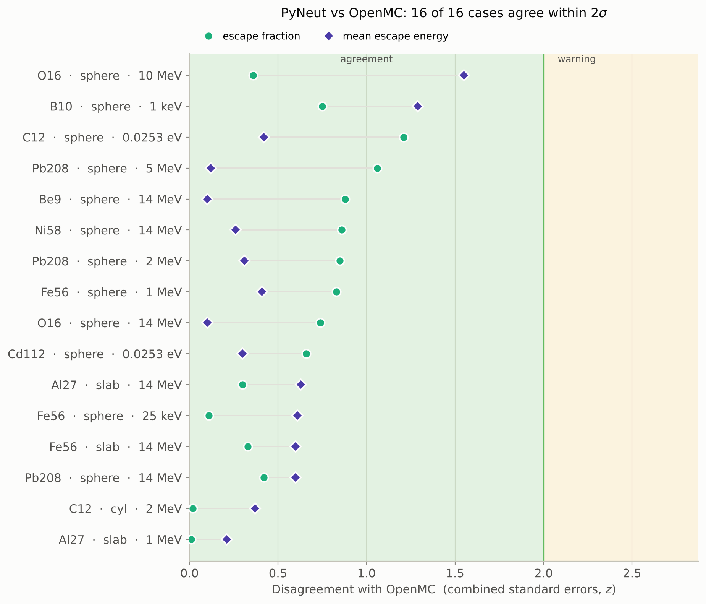

<p align="center">
  
</p>

# PyNeut — Python Neutronics

A continuous-energy Monte Carlo neutron transport code in Python. It reads
ENDF/B-VIII.0 data directly (OpenMC HDF5 format) and is validated against
OpenMC, against analytic results and against ICSBEP critical benchmarks.
**For education and research prototyping, not for production or safety work.**

[](https://github.com/ybadr16/PyNeut/actions/workflows/tests.yml)
[](https://www.python.org/)
[](LICENSE)

<p align="center">
  
</p>

## What it does

- **Physics:** elastic scattering with tabulated ENDF angular distributions,
  plus free-gas thermal motion below 10 eV. Discrete inelastic levels, and
  continuum and (n,2n)/(n,3n) emission through ENDF Law 61 / Kalbach–Mann.
  Every other reaction in the file, such as (n,np), (n,nα) and (n,anything),
  emitted with its tabulated yield, so the total cross section is the
  evaluation's own. Capture and charged-particle absorption,
  unresolved-resonance probability tables, and fission with ν̄ and a Watt
  spectrum.
- **Input files:** a whole calculation is one TOML file: materials, geometry
  written as region expressions (`"-outer & -top & +bottom"`), source
  distributions, tallies and run settings. `pyneut check` validates it and
  `pyneut run` solves it, recording the input, code and data that produced
  the result.
- **Problems:** fixed-source shielding (analog, or implicit capture with Russian
  roulette) and k-eigenvalue by fission-source power iteration.
- **Geometry:** constructive solid geometry from planes, spheres, axis-aligned
  cylinders and boxes. Regions can be nested, have priorities, be voids, or
  have reflective boundaries.
- **Materials:** one isotope or a multi-isotope mixture per region. The reacting
  isotope is sampled at each collision.
- **Two engines that share the same physics:**
  - `simulation.py` follows one neutron at a time. It is the readable
    reference implementation.
  - `vector_transport.py` advances the whole particle bank one event at a time
    with NumPy. It is 6–58× faster on a single core.
  Both parallelise across cores with `multiprocessing`.
- **Tallies:**
  - flux (track-length or collision estimator), absorption and leakage;
  - filtered by cell, energy and a 3-D mesh, in any combination, on either
    engine and in either mode;
  - batch-means errors on every bin;
  - mesh maps written as VTK for ParaView.

## Validation at a glance

| Check | Result |
|-------|--------|
| 16 fixed-source cases vs OpenMC 0.15 (Pb208, Fe56, Be9, Al27, C12, O16, Ni58, B10, Cd112; thermal to 14 MeV) | **16 OK, 0 warnings, 0 failures** (OK means within 2σ) |
| ICSBEP Godiva / Jezebel-23 / Jezebel | k_eff within **0.8σ** of the benchmark and **1.3σ** of OpenMC |
| Bare U235 spheres, R = 6 / 8.7 / 11 cm, vs OpenMC eigenvalue mode | z = 1.5 / 2.0 / 2.2 |
| BEAVRS pin cell, k∞ with matched physics (5 seeds per code) | **+72 ± 98 pcm**, z = 0.74 |
| B10 + C12 mixture vs OpenMC | leakage within 0.1σ, escape energy within 0.2σ |
| Analytic: Beer–Lambert attenuation, elastic [α,1] and ξ | 13 / 13 pass |
| Cross-section reader vs `openmc.data` (elastic, capture, (n,2n), and the total) | identical (0.000 %) for every isotope |

All 16 spectrum shapes are GOOD as well. Until October 2026 the total cross
section left out reactions such as (n,np) and (n,nα), which made the 14 MeV
Al27, O16 and Ni58 cases fail by 12–33σ on mean escape energy. Every reaction
is now counted, as the
[validation report](docs/index.md#reactions-above-5-mev) shows.

The [validation report](docs/index.md) has the full tables, the method, and
the tally comparison against OpenMC.

<p align="center">
  
</p>

## Install

```bash
git clone https://github.com/ybadr16/PyNeut.git
cd PyNeut
pip install -e .               # runtime: numpy, h5py
pip install -e ".[test]"       # + pytest, trimesh, rtree
pip install -e ".[validation]" # + openmc, matplotlib (OpenMC comparison suite)
```

The package is imported as `pyneut` (`from pyneut.simulation import ...`), and
installing it also provides a `pyneut` command.

### Nuclear data

The ENDF/B-VIII.0 files are **not** in the repository. One script fetches
the ones PyNeut uses from OpenMC's official HDF5 library
([openmc.org/data-libraries](https://openmc.org/data-libraries/)) into
`endfb/neutron/`:

```bash
python tools/fetch_data.py                      # all 50 nuclides (~0.8 GB kept)
python tools/fetch_data.py --set fixed-source   # or: keff, pincell
python tools/fetch_data.py --verify             # check the files you have
```

It checks every file against the SHA-256 of the snapshot the committed
validation results were produced with (`tools/endfb-viii.0.sha256`), so a
match means your results should reproduce the tables. The 3.4 GB archive is
streamed, and only the requested files are written.

> A nuclide name with no matching file is an error, both in input files and
> in the Python API, so a misspelt name cannot silently act as vacuum.

## Quick start

A model is one TOML file. This is a 2 MeV point source at the centre of a
10 cm Pb208 sphere:

```toml
# pb_sphere.toml
[run]
mode      = "fixed-source"
particles = 10_000
seed      = 12345

[materials.lead]
density  = 11.35                 # g/cm3; the AWR is read from Pb208.h5
nuclides = { Pb208 = 1.0 }

[surfaces]
shell = { type = "sphere", center = [0, 0, 0], radius = 10.0 }

[cells]
shield = { region = "-shell", material = "lead" }

[source]
space     = { type = "point", xyz = [0, 0, 0] }
direction = "isotropic"
energy    = "2 MeV"

[tallies.leakage]
type        = "leakage"
energy_bins = { log = ["1 keV", "2.1 MeV", 60] }
```

```bash
pyneut check pb_sphere.toml    # validates the input, data, source and geometry
pyneut run   pb_sphere.toml    # solves; writes pb_sphere_results/results.json
```

`results.json` holds every tally with its standard errors, plus the
provenance of the run: the input's hash, the code version and git commit,
and a fingerprint of the nuclear data. The same model from Python:

```python
from pyneut.model import Model

model = Model.from_toml("pb_sphere.toml")
model.run.engine = "scalar"            # override anything before solving
results = model.solve()
print(results.summary())
```

- [`examples/`](examples/README.md) has an input for every validated case
  (all 16 fixed-source cases, Godiva, Jezebel, Jezebel-23, the U235 spheres
  and the BEAVRS pin cell) and one for each feature.
- The [input format reference](docs/input-format.md) documents every key.
- The [Quick Start guide](docs/QUICK_START.md) covers the low-level Python
  API underneath.

## Repository layout

```
pyneut/                    the package
  cross_section_read.py      ENDF HDF5 reader: XS, angular/secondary distributions, ν̄, URR
  angular_distribution.py    tabulated elastic (MT 2) cosine sampling
  material.py                Material, Nuclide, Material.mixture
  medium.py                  CSG: Region, Plane, Cylinder, Sphere, Box
  geometry.py                ray–surface crossing search, reflection
  physics.py                 elastic/inelastic kinematics, evaporation, Watt χ
  vt_calc.py                 free-gas target-velocity sampling
  simulation.py              one-neutron-at-a-time transport kernel (reference engine)
  vector_transport.py        event-based NumPy engine + multiprocessing wrappers
  criticality.py             k-eigenvalue power iteration (scalar engine)
  model.py                   TOML input: Model, validation, solve, results
  tallies.py                 event Scorer shared by both engines: flux, absorption, leakage
  regions.py, sources.py     region-expression parser, source distributions
  cli.py                     the `pyneut` command (check, run)
  settings.py, tally.py, statistics.py, mesh.py, random_number_generator.py
examples/                  input files for every validated case and every feature
tests/                     pytest suite (42 tests need ENDF data and skip without it)
Validation/
  analytic_benchmarks.py     exact analytic checks, no OpenMC needed
  OpenMC_Comparison/         live PyNeut-vs-OpenMC suite, see its README
tools/                     data fetch script, figure scripts (validation summary, geometry maps, spectra)
docs/                      validation report, quick start, API reference, images
Animation/                 Manim trajectory replay
main.py                    end-to-end example with a mesh tally
```

## Testing

```bash
pytest                                                  # unit tests
python Validation/analytic_benchmarks.py                # analytic benchmarks (needs data)
cd Validation/OpenMC_Comparison && python run_all.py    # vs OpenMC (needs data + openmc)
```

## Main limitations

- Thermal scattering is free-gas only. There is no S(α,β), so bound moderators
  such as water and graphite are approximate.
- Fission uses a Watt χ and total ν̄. There is no tabulated ENDF χ and no
  separate delayed neutrons.
- Neutrons only. Charged particles and photons are not transported.
- Sources are built by hand, as per-particle dicts or arrays.
- Only one temperature (294 K) is loaded.
- Geometry covers planes, spheres and axis-aligned cylinders and boxes, with no
  rotations.

The full list, with how each item shows up in the validation, is in
[docs/index.md](docs/index.md#limitations).

## Roadmap

1. **Animation pipeline.** Replace the bare-coordinate JSON export with a
   self-describing bundle: serialised geometry, plus per-vertex
   energy/event/weight tagged by `parent_id`. A generic 3-D Manim scene would
   then need no hand-editing.
2. **Criticality.** Read the tabulated ENDF χ, separate prompt and delayed ν̄,
   add reflected and thermal-solution benchmarks, and ship a small fissile data
   subset so the benchmarks run without the full library.
3. **Performance.** The vector engine is done. A Numba-compiled kernel is in
   progress on the `numba-experiment` branch.
4. **Tallies.** Track-length flux on meshes, surface-current tallies, and
   detector tallies on the vector engine.
5. **Physics.** S(α,β), multi-temperature data and a natural-abundance
   database.

## Documentation

- [Validation report](docs/index.md): method, every result table, physics
  models, limitations
- [Input format reference](docs/input-format.md) and [examples](examples/README.md)
- [Quick Start](docs/QUICK_START.md): the low-level Python API, with worked examples
- [API reference](docs/api-reference.md)
- [Validation suite guide](Validation/OpenMC_Comparison/README.md)
- [Contributing](CONTRIBUTING.md)

## References

- ENDF/B-VIII.0: https://www.nndc.bnl.gov/endf/
- OpenMC theory manual: https://docs.openmc.org/en/stable/methods/index.html
- Duderstadt & Hamilton, *Nuclear Reactor Analysis*
- J. Wood, *Computational Methods in Reactor Shielding*

## License and contact

MIT, see [LICENSE](LICENSE). Youssef, Nuclear and Radiation Engineering,
Alexandria University. Bug reports and questions go to
[GitHub issues](https://github.com/ybadr16/PyNeut/issues).
