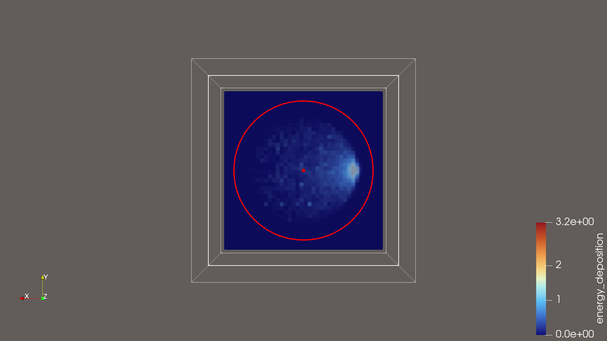

# Quick Start: the Python API

> **Most calculations don't need Python.** A TOML input file describes the
> whole model, and `pyneut run model.toml` solves it. See the
> [input format reference](input-format.md) and the
> [examples](../examples/README.md); most examples below have an input-file
> twin there. This guide covers the low-level Python API that input files are
> built on. Use it to script something the input format can't express yet.

Worked examples, from a single shielding run up to k-eigenvalue and the vector
engine. Every example is a complete script. Run it from the repository root
with the ENDF/B-VIII.0 HDF5 files in `./endfb/neutron/` (see the
[README](https://github.com/ybadr16/PyNeut#nuclear-data)).

- [Conventions](#conventions)
- [1. Leakage from a slab](#1-leakage-from-a-slab)
- [2. A detector behind a shield](#2-a-detector-behind-a-shield)
- [3. Escape-energy spectrum](#3-escape-energy-spectrum)
- [4. Mesh tally for ParaView](#4-mesh-tally-for-paraview)
- [5. Recording trajectories](#5-recording-trajectories)
- [6. Material mixtures](#6-material-mixtures)
- [7. Reflective boundaries](#7-reflective-boundaries)
- [8. k-eigenvalue: Godiva](#8-k-eigenvalue-godiva)
- [9. The vector engine](#9-the-vector-engine)
- [Pitfalls](#pitfalls)

## Conventions

- **Units:** energy in **eV**, lengths in **cm**, density in g/cm³, number
  densities in atoms/cm³.
- **Direction:** `theta` is the polar angle measured from **+z** and `phi` the
  azimuth from +x, so `(theta, phi) = (π/2, 0)` points along +x. An isotropic
  direction is `theta = arccos(1 − 2ξ)`, `phi = 2πξ′`. `theta = uniform(0, π)`
  is **not** isotropic.
- **Masses:** `atomic_weight_ratio` (AWR) is the target-to-neutron mass ratio
  from the data file (Pb208: 206.190). The molar mass in g/mol is
  `AWR × NEUTRON_MASS_AMU`. Mixing these two up shifts both the kinematics and
  the number density by about 1 %.
- **The scalar engine** (`simulate_single_particle`) takes one 10-tuple per
  source neutron:

  ```python
  (state, reader, regions, A, N, sampler, region_bounds, track_coordinates, rng, settings)
  ```

  `A`, `N` and `sampler` belong to the single isotope named by
  `Region(element=...)`. Regions given a `composition=` ignore them.
- **Modes:** `Settings(mode="shielding")` uses implicit capture with Russian
  roulette and is the right choice for leakage. `mode="criticality"` is analog
  transport, which you need for fission banking and for unweighted event counts.
- **`multiprocessing`:** keep the `Pool` under `if __name__ == "__main__":`.
  This is required on Windows and macOS.

Every scalar example below starts from this shared setup. It is repeated in
each script so that each one runs on its own:

```python
import numpy as np
from multiprocessing import Pool

from pyneut.cross_section_read import CrossSectionReader
from pyneut.material import Material, NEUTRON_MASS_AMU
from pyneut.medium import Region, Plane, Box
from pyneut.random_number_generator import RNGHandler
from pyneut.settings import Settings
from pyneut.simulation import simulate_single_particle
from pyneut.tally import Tally
from pyneut.vt_calc import VelocitySampler

AWR = 206.190                                     # Pb208
reader = CrossSectionReader("./endfb")
lead = Material("Pb208", 11.35, AWR * NEUTRON_MASS_AMU, atomic_weight_ratio=AWR)
sampler = VelocitySampler(lead.kg_mass)
```

---

## 1. Leakage from a slab

A 1 MeV pencil beam hits a 10 cm Pb208 slab face-on. The slab is wrapped in a
void box so the source, which starts outside the lead, is inside the geometry.
A neutron that leaves every region has leaked.

```python
import numpy as np
from multiprocessing import Pool

from pyneut.cross_section_read import CrossSectionReader
from pyneut.material import Material, NEUTRON_MASS_AMU
from pyneut.medium import Region, Box
from pyneut.random_number_generator import RNGHandler
from pyneut.settings import Settings
from pyneut.simulation import simulate_single_particle
from pyneut.tally import Tally
from pyneut.vt_calc import VelocitySampler

AWR = 206.190

if __name__ == "__main__":
    reader = CrossSectionReader("./endfb")
    lead = Material("Pb208", 11.35, AWR * NEUTRON_MASS_AMU, atomic_weight_ratio=AWR)
    sampler = VelocitySampler(lead.kg_mass)

    regions = [
        Region(surfaces=[Box(0, 10, -50, 50, -50, 50)],          # 0 <= x <= 10
               name="Lead slab", priority=1, element="Pb208"),
        Region(surfaces=[Box(-20, 30, -60, 60, -60, 60)],
               name="Void", priority=0, is_void=True),
    ]

    settings = Settings(mode="shielding", particles=5000)
    n = settings.num_particles
    rngs = [RNGHandler(seed=1000 + i) for i in range(n)]
    states = [{"x": -5.0, "y": 0.0, "z": 0.0,
               "theta": np.pi / 2, "phi": 0.0,                     # +x
               "energy": 1e6, "weight": 1.0, "has_interacted": False}
              for _ in rngs]

    args = [(s, reader, regions, lead.atomic_weight_ratio, lead.number_density,
             sampler, None, False, r, settings) for s, r in zip(states, rngs)]
    with Pool() as pool:
        results = pool.map(simulate_single_particle, args)

    tally = Tally()
    for res in results:
        tally.merge_partial_results(res)

    stats = tally.statistics(n)        # batch-means mean ± standard error
    print(f"leakage  = {stats['leakage']:.4f} ± {stats['leakage_sem']:.4f}")
    print(f"<E_out>  = {stats['avg_energy']:.4e} ± {stats['avg_energy_sem']:.1e} eV")
    print(f"absorbed = {tally.results['absorbed'] / n:.4f}")
```

The leakage counts weight that leaves through **any** face, so neutrons
reflected back toward the source are included. Use a detector (example 2) to
count only the neutrons transmitted through the slab. Leakage and absorbed
weight should add up to about 1. Roulette makes the balance hold on average,
not exactly in every run.

## 2. A detector behind a shield

`region_bounds = (x_min, x_max, y_min, y_max, z_min, z_max)` marks a detector
box, and `tally.region_count` counts the **histories** that reach it.
Detection is only tested at the points where a neutron stops: collisions and
surface crossings. A box drawn in open void can be flown through without being
noticed. To avoid this, give the detector its own void region, so a neutron
entering it must cross its surface. The count is unweighted, so use analog
mode for it.

```python
import numpy as np
from multiprocessing import Pool

from pyneut.cross_section_read import CrossSectionReader
from pyneut.material import Material, NEUTRON_MASS_AMU
from pyneut.medium import Region, Cylinder, Plane, Box
from pyneut.random_number_generator import RNGHandler
from pyneut.settings import Settings
from pyneut.simulation import simulate_single_particle
from pyneut.tally import Tally
from pyneut.vt_calc import VelocitySampler

AWR = 206.190

if __name__ == "__main__":
    reader = CrossSectionReader("./endfb")
    lead = Material("Pb208", 11.35, AWR * NEUTRON_MASS_AMU, atomic_weight_ratio=AWR)
    sampler = VelocitySampler(lead.kg_mass)

    detector = (15.0, 17.0, -5.0, 5.0, -5.0, 5.0)
    regions = [
        Region(surfaces=[Cylinder("z", 10, (0, 0, 0)),
                         Plane(0, 0, 1, 10), Plane(0, 0, -1, 10)],   # |z| <= 10
               name="Shield", priority=2, element="Pb208"),
        Region(surfaces=[Box(*detector)], name="Detector", priority=1, is_void=True),
        Region(surfaces=[Box(-20, 20, -20, 20, -20, 20)],
               name="Void", priority=0, is_void=True),
    ]

    settings = Settings(mode="criticality", particles=5000)   # analog transport
    n = settings.num_particles
    rngs = [RNGHandler(seed=2000 + i) for i in range(n)]
    states = [{"x": -15.0, "y": 0.0, "z": 0.0,
               "theta": np.arccos(1 - 2 * r.random()),          # isotropic
               "phi": r.uniform(0, 2 * np.pi),
               "energy": 1e6, "weight": 1.0, "has_interacted": False}
              for r in rngs]

    args = [(s, reader, regions, lead.atomic_weight_ratio, lead.number_density,
             sampler, detector, False, r, settings) for s, r in zip(states, rngs)]
    with Pool() as pool:
        results = pool.map(simulate_single_particle, args)

    tally = Tally()
    for res in results:
        tally.merge_partial_results(res)
    p = tally.region_count / n
    print(f"P(reach detector) = {p:.4f} ± {np.sqrt(p * (1 - p) / n):.4f}")
```

## 3. Escape-energy spectrum

Each history reports the weight it leaked (`final_weight`) and the
weight-averaged energy it leaked at (`final_energy`, which is 0 if nothing
leaked). Each history has a single neutron unless (n,xn) or fission adds more.
For those simple problems, histogramming these values with the leaked weight
as the histogram weight gives the leakage spectrum. Continuing from example 1:

```python
import matplotlib.pyplot as plt

E = np.array(tally.energy_spectrum)
w = np.array(tally.leaked_weights)
bins = np.logspace(3, 6.1, 60)                     # 1 keV .. ~1.26 MeV
hist, edges = np.histogram(E[w > 0], bins=bins, weights=w[w > 0])

plt.stairs(hist / n, edges)
plt.xscale("log")
plt.xlabel("Escape energy (eV)")
plt.ylabel("Leaked weight per source neutron")
plt.savefig("escape_spectrum.png", dpi=200)
```

This per-history histogram is only right when each history leaks at most one
neutron. When (n,xn) or fission makes one history leak several, it puts all
of their weight at their average energy. The leakage tally of the input
format, or a `pyneut.tallies.Scorer` passed to the engine, scores each
neutron at its own energy instead:

```python
from pyneut.tallies import Scorer, TallyDef

scorer = Scorer([TallyDef("leak", "leakage", energy_bins=bins)], n_batches=1)
args = [a + (scorer,) for a in args]            # an optional 11th element
results = [simulate_single_particle(a) for a in args]
leak = scorer.finalize([n])["leak"]             # per source neutron
print(leak["total"], leak["mean"])              # total, and per energy bin
```

A scorer can't be shared between processes, so this runs serially. For
parallel runs, the input format handles splitting the work and merging.

## 4. Mesh tally for ParaView

In `shielding` mode every collision removes weight to implicit capture. Each
history returns those removals as `absorbed_coords`, a list of
`(x, y, z, weight_lost)`. Scoring them on a `MeshTally` gives an absorption
map:

```python
from pyneut.mesh import MeshTally

mesh = MeshTally(x_bounds=(-15, 15), y_bounds=(-15, 15), z_bounds=(-15, 15),
                 dims=(40, 40, 40))
for res in results:
    for x, y, z, w_lost in res["absorbed_coords"]:
        mesh.score(x, y, z, w_lost)
mesh.write_vtk("dose_map.vtk")          # open in ParaView
```

`main.py` runs this end to end, with a 50 eV beam into a B10 cylinder:

<p align="center">
  
</p>

## 5. Recording trajectories

Pass `track_coordinates=True`. Each result's `trajectory` is then a list of
`(x, y, z)` points for the source neutron and its descendants, concatenated
into one list. Keep the run small.

```python
import json

args = [(s, reader, regions, lead.atomic_weight_ratio, lead.number_density,
         sampler, None, True, r, settings) for s, r in zip(states[:20], rngs[:20])]
with Pool() as pool:
    results = pool.map(simulate_single_particle, args)

tracks = {i: res["trajectory"] for i, res in enumerate(results)}
with open("all_trajectories.json", "w") as f:
    json.dump(tracks, f)
```

`Animation/` replays this file with Manim. Its README explains how.

## 6. Material mixtures

A region can hold several isotopes. Give it `composition=` as a list of
`Nuclide`s, either built by hand with explicit number densities or by
`Material.mixture` from a density and atom fractions. The reacting isotope is
sampled per collision in proportion to its share of the total cross section.
The `A`, `N` and `sampler` slots of the args tuple are ignored for such
regions.

```python
import numpy as np
from multiprocessing import Pool

from pyneut.cross_section_read import CrossSectionReader
from pyneut.material import Material
from pyneut.medium import Region, Sphere
from pyneut.random_number_generator import RNGHandler
from pyneut.settings import Settings
from pyneut.simulation import simulate_single_particle
from pyneut.tally import Tally
from pyneut.vt_calc import VelocitySampler

if __name__ == "__main__":
    reader = CrossSectionReader("./endfb")

    # B4C made with pure B10: 4 B : 1 C atoms at 2.52 g/cm3.
    # Each component is (element, AWR, atom fraction) or (element, AWR, fraction, molar mass).
    b4c = Material.mixture("B4C", 2.52, [("B10", 9.926900, 4.0),
                                         ("C12", 11.896910, 1.0)])
    for nuc in b4c:
        print(nuc)

    regions = [Region(surfaces=[Sphere((0, 0, 0), 5.0)], name="B4C",
                      priority=1, composition=b4c)]

    settings = Settings(mode="shielding", particles=5000)
    n = settings.num_particles
    rngs = [RNGHandler(seed=3000 + i) for i in range(n)]
    states = [{"x": 0.0, "y": 0.0, "z": 0.0,
               "theta": np.arccos(1 - 2 * r.random()), "phi": r.uniform(0, 2 * np.pi),
               "energy": 1e6, "weight": 1.0, "has_interacted": False} for r in rngs]

    # A, N, sampler are unused for composition regions; pass placeholders
    args = [(s, reader, regions, 1.0, 1.0, VelocitySampler(1.0), None, False, r, settings)
            for s, r in zip(states, rngs)]
    with Pool() as pool:
        results = pool.map(simulate_single_particle, args)

    tally = Tally()
    for res in results:
        tally.merge_partial_results(res)
    tally.print_summary(n)
```

To give number densities directly, use
`Nuclide("B10", 1.0992e23, 9.926900)` (atoms/cm³, then AWR).

## 7. Reflective boundaries

Every surface takes `boundary_type="reflective"`. A neutron that reaches it is
reflected like a mirror instead of leaving. An all-reflective box is an
infinite medium or an infinite lattice: this is how `validate_pincell.py`
builds the BEAVRS pin cell. In a fixed-source problem with no leakage, every
history ends in absorption or roulette:

```python
from pyneut.medium import Plane, Region

half = 0.63
walls = [Plane(-1, 0, 0, half, boundary_type="reflective"),   # x >= -half
         Plane( 1, 0, 0, half, boundary_type="reflective"),   # x <=  half
         Plane(0, -1, 0, half, boundary_type="reflective"),
         Plane(0,  1, 0, half, boundary_type="reflective"),
         Plane(0, 0, -1, half, boundary_type="reflective"),
         Plane(0, 0,  1, half, boundary_type="reflective")]
cell = Region(surfaces=walls, name="Infinite lead", priority=1, element="Pb208")
```

`Plane(A, B, C, D)` is the half-space `A·x + B·y + C·z ≤ D`. The examples use
`Box(x_min, x_max, ...)` where a box is all that's needed. `Box`, `Sphere` and
`Cylinder` accept `boundary_type` too.

## 8. k-eigenvalue: Godiva

`criticality.run_keff` runs the fission-source power iteration on the scalar
engine. `criticality.uniform_sphere_source` builds a first-generation source
with Watt-spectrum energies. This is the Godiva benchmark (HEU-MET-FAST-001,
published k_eff = 1.0000):

```python
from multiprocessing import Pool

from pyneut.criticality import run_keff, uniform_sphere_source
from pyneut.cross_section_read import CrossSectionReader
from pyneut.material import Nuclide
from pyneut.medium import Region, Sphere
from pyneut.random_number_generator import RNGHandler
from pyneut.settings import Settings
from pyneut.vt_calc import VelocitySampler

R = 8.7407                                   # cm
# (element, atoms/b-cm, AWR, molar mass)
GODIVA = [("U234", 4.8271e-04, 232.030, 234.04),
          ("U235", 4.4994e-02, 233.025, 235.04),
          ("U238", 2.4984e-03, 236.006, 238.05)]

if __name__ == "__main__":
    reader = CrossSectionReader("./endfb")
    core = [Nuclide(el, nd * 1e24, awr, atomic_mass=m) for el, nd, awr, m in GODIVA]
    regions = [Region(surfaces=[Sphere((0, 0, 0), R)], name="core",
                      priority=1, composition=core)]

    source = uniform_sphere_source((0, 0, 0), R, 2000, RNGHandler(1), element="U235")
    settings = Settings("criticality")       # analog: fission neutrons are banked

    with Pool() as pool:
        out = run_keff(reader, regions, source, 1.0, 1.0, VelocitySampler(1.0),
                       settings, generations=120, inactive=20, seed=1, pool=pool)

    print(f"k_eff = {out['k_eff']:.5f} ± {out['k_sem']:.5f}  (collision estimator)")
    print(f"k_src = {out['k_source']:.5f} ± {out['k_source_sem']:.5f}  (generation ratio)")
```

`out["cycles"]` holds `(generation, k_collision, k_source, is_active)` for each
generation, so you can plot convergence from it. The full benchmark set, with
OpenMC alongside, is `Validation/OpenMC_Comparison/validate_keff.py --benchmarks`.

## 9. The vector engine

`pyneut.vector_transport` runs the same physics on a whole bank at once and is
6–58× faster on a single core. It works with arrays, not dicts:

- The source is a dict of equal-length arrays `x, y, z, u, v, w, energy`
  (direction cosines, not angles), with an optional `weight`.
- `rng` is a `numpy.random.Generator`.
- Every material region must carry a `composition`. Alternatively, pass
  `legacy=(A, N, sampler)` for `element=` regions.

```python
import numpy as np

from pyneut import vector_transport as vt
from pyneut.cross_section_read import CrossSectionReader
from pyneut.material import Nuclide
from pyneut.medium import Region, Sphere
from pyneut.settings import Settings
from pyneut.statistics import escape_statistics

reader = CrossSectionReader("./endfb")
lead = Nuclide("Pb208", 11.35 * 6.022e23 / (206.190 * 1.00866491588), 206.190)
regions = [Region(surfaces=[Sphere((0, 0, 0), 10.0)], name="Lead",
                  priority=1, composition=[lead])]

n = 100_000
rng = np.random.default_rng(12345)
mu = rng.uniform(-1, 1, n)
phi = rng.uniform(0, 2 * np.pi, n)
s = np.sqrt(1 - mu ** 2)
source = {"x": np.zeros(n), "y": np.zeros(n), "z": np.zeros(n),
          "u": s * np.cos(phi), "v": s * np.sin(phi), "w": mu,
          "energy": np.full(n, 2.0e6)}

res = vt.run_transport(reader, regions, source, rng, Settings("shielding", n))
stats = escape_statistics(res["leaked_weight"], res["escape_energy"], n)
print(f"leakage = {stats['leakage']:.5f} ± {stats['leakage_sem']:.5f}")
print(res["counters"])
```

To use every core, give the data directory instead of a reader:
`vt.run_transport_parallel("./endfb", regions, source, settings, n_workers=8, seed=0)`.
For k-eigenvalue there are `vt.run_keff_vector(reader, regions, source, settings, ...)`,
which takes an array source, and `vt.run_keff_parallel(...)`, which runs
independent replicas, one per seed. For a lattice near k = 1, the spread
between replicas is the honest error bar.

---

## Pitfalls

- **Misspelt nuclide names fail silently.** A name with no
  `endfb/neutron/<name>.h5` file gets zero cross sections, and the region acts
  as vacuum. If a result looks too transparent, check the name first.
- **The source sits outside every region.** That neutron is scored as escaped
  immediately. Wrap the problem in a void region that contains the source and
  any gaps (example 1).
- **Overlapping regions.** Where regions overlap, the one with the highest
  `priority` wins. Give nested regions strictly decreasing priorities from the
  inside out.
- **The molar mass passed as AWR, or the reverse.** See
  [Conventions](#conventions).
- **Non-isotropic "isotropic" sources.** `theta = uniform(0, π)` piles
  directions up at the poles. Use `arccos(1 − 2ξ)`.
- **Using `tally.results["escaped"]` for leakage.** That counter is not filled
  by `simulate_single_particle`. Use `tally.statistics(n)["leakage"]`, or the
  summary from `print_summary`.

## Performance

- For anything above a few thousand histories, use the vector engine (example 9).
- Leave `track_coordinates` off except for small runs.
- Create one `CrossSectionReader` and reuse it. It caches every table it loads.
- Reflective lattices and thermal problems run long histories. Budget
  accordingly, or start with a small `n`.
