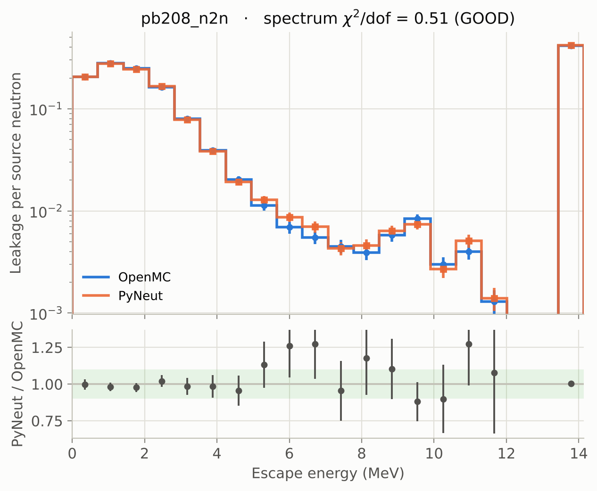

  

# PyNeut validation report

PyNeut is a continuous-energy Monte Carlo neutron transport code in Python,
driven by ENDF/B-VIII.0 data. This page explains how PyNeut is checked, gives
every result, and describes the physics behind the numbers and its limits.
Installation and usage are in the [README](https://github.com/ybadr16/PyNeut#readme),
the [Quick Start](QUICK_START.md) and the [API reference](api-reference.md).

**Contents:** [Method](#method) ·
[Fixed source](#fixed-source-transport-vs-openmc) ·
[Mixtures](#material-mixtures) ·
[Criticality](#criticality-k-eigenvalue) ·
[Pin cell](#beavrs-pin-cell-k) ·
[Vector engine](#vector-engine) ·
[Analytic and data checks](#analytic-and-data-layer-checks) ·
[Physics](#physics-models) ·
[Limitations](#limitations)

  

---

## Method

The OpenMC (0.15) reference results are generated **live**, from the same
ENDF/B HDF5 files PyNeut reads, with identical geometry and source. The
scripts are in `Validation/OpenMC_Comparison/`. The comparison is built to
avoid three common traps:

- **Graded by statistical significance, not percent difference.** Both codes
  report a standard error: batch means for PyNeut, OpenMC's own batch
  statistics for OpenMC. Agreement is graded by
  `z = |OpenMC − PyNeut| / √(σ²_OMC + σ²_PyN)`:
  **OK ≤ 2σ, WARNING ≤ 4σ, FAIL > 4σ**. A large z flags a real bias even when
  the percent difference looks tiny.
- **The same estimator in both codes.** The mean escape energy is taken from
  the same energy histogram in both codes, so the binning bias cancels. Without
  this, two cases that looked like sub-0.3 % passes turned out to be artifacts
  of the reference binning.
- **Spectrum shape is graded separately from the integrals.** The leakage
  spectrum is compared with a coarse-group χ²/dof (GOOD ≤ 2, FAIR ≤ 5,
  POOR > 5), reported independently of the integral status.

**Matched masses.** Every case takes the target mass from the data file's
atomic-weight ratio (AWR), and `_common.py` refuses a case whose declared AWR
disagrees with the file. Six case files once supplied the molar mass in g/mol
instead. That gave the two codes masses and number densities that differed by
0.5–1.0 %, and caused a spurious 2.1σ warning on `c12_cyl_2mev`.

The committed results were produced against a data snapshot fingerprinted in
`validation_manifest.json` (48 files, measured 2026-08-08). A cross-code
comparison holds only for one data snapshot. The pin cell, for example, moves
by about 330 pcm across an evaluation refresh.

---

## Fixed-source transport vs OpenMC

N = 10 000 histories per case, from a monoenergetic isotropic point source at
the origin. Dimensions are in cm, and slabs are 100 × 100 cm in the other two
directions. Source: `Validation/OpenMC_Comparison/validation_results.csv`.

| Case | E | Regime | Leak z | E z | Integral | Spectrum (χ²/dof) |
|------|--:|--------|------:|----:|:--------:|:-----------------:|
| Pb208 sphere R=10 | 2 MeV | fast, elastic | 0.9 | 0.3 | OK | GOOD (0.90) |
| Pb208 sphere R=10 | 5 MeV | fast | 1.1 | 0.1 | OK | GOOD (0.65) |
| Pb208 sphere R=10 | 14 MeV | fast, (n,2n) | 0.4 | 0.6 | OK | **POOR (29)** |
| Fe56 slab, 4 thick | 14 MeV | fast, (n,xn) | 2.5 | 1.4 | **WARN** | **POOR (5.5)** |
| Fe56 sphere R=10 | 1 MeV | fast | 0.8 | 0.4 | OK | GOOD (1.0) |
| Fe56 sphere R=15 | 25 keV | intermediate | 0.1 | 0.6 | OK | GOOD (0.85) |
| Be9 sphere R=10 | 14 MeV | fast, (n,2n) | 0.9 | 0.1 | OK | **POOR (46)** |
| Al27 slab, 1 thick | 1 MeV | fast | 0.0 | 0.2 | OK | GOOD (0.76) |
| C12 cylinder R=10, height 20 | 2 MeV | fast | 0.0 | 0.4 | OK | GOOD (0.78) |
| O16 sphere R=20 | 10 MeV | fast | 0.4 | 1.6 | OK | GOOD (1.0) |
| B10 sphere R=1 | 1 keV | epithermal | 0.6 | 1.2 | OK | **POOR (15)** |
| Cd112 sphere R=2 | 0.0253 eV | thermal | 0.7 | 0.3 | OK | GOOD (0.08) |
| C12 sphere R=5 | 0.0253 eV | thermal | 1.2 | 0.4 | OK | GOOD (0.47) |

**12 OK, 1 warning, 0 failures.**

  
  

**Fast neutrons (the intended domain).** Leakage and mean escape energy agree
within about 2σ everywhere. The spectrum shape is GOOD for the elastic,
discrete-inelastic and resonance cases.

**Thermal.** Below 10 eV elastic scattering uses free-gas kinematics: the
target's 294 K motion is sampled, so neutrons can gain energy and settle into
the medium's Maxwellian. `c12_thermal` and `cd112_thermal` agree within 0.4σ
on mean escape energy, with GOOD shape. These two used to be the suite's
failures (c12 was 86σ off) with a stationary-target kernel. After that fix a
~3 % hot bias remained. It came from three compounding errors:

1. The flight cross section was Doppler-broadened again, although the library
   data is already broadened.
2. The free-gas branch probability used the raw neutron speed instead of the
   dimensionless ratio βv.
3. The target mass was taken as the AWR instead of AWR·mₙ.

All three are fixed. OpenMC also runs free-gas here (no S(α,β)).

**(n,2n) and the POOR spectrum shapes.** The two (n,2n) spheres agree on
leakage and mean escape energy, but their spectrum shapes are POOR
(χ²/dof 29 and 46). Fe56 at 14 MeV shows the same effect at lower strength
(5.5) and carries the one integral warning. The single-collision emission
itself has been checked against OpenMC point by point at the incident-energy
grid nodes (`validate_secondary.py`, outgoing-energy χ²/dof ≈ 1 for Be9, Fe56
and Pb208 at 14 MeV). Three things are applied:

- the CM→lab boost for reactions given in the CM frame,
- unit-base outgoing-energy interpolation between incident grids,
- the correlated emission angle (Law 61 / Kalbach–Mann).

The Maxwellian-evaporation fallback is used **0 %** of the time. (An earlier
"18 % / χ² ≈ 86" emission bias was a diagnostic artifact: OpenMC's incident
block *i* was compared against PyNeut's block *i+1*.) The working explanation
is that PyNeut samples the emitted neutrons independently, with no constraint
on their total energy. That would change the spectrum shape while keeping the
neutron count, and so the integral leakage, correct. B10 at 1 keV is also
POOR (15) without any (n,xn). B10 is a near-black absorber, so its leaked
spectrum is sparse and noisy.

Each case's spectrum can be inspected directly. `run_all.py --plots` writes
one panel per case to `images/cases/`:

  

---

## Material mixtures

`validate_mixture.py` tests per-collision isotope selection on a B4C-like
**B10 + C12** sphere (a strong absorber plus a moderator), with identical
number densities in both codes, at N = 40 000:

| Metric | OpenMC | PyNeut | z |
|--------|-------:|-------:|--:|
| leakage | 0.69090 ± 0.00280 | 0.69077 ± 0.00157 | 0.0 |
| mean escape energy (eV) | 772 558 | 771 890 | 0.4 |

The spectrum shape is GOOD (χ²/dof = 1.4).

---

## Criticality (k-eigenvalue)

`validate_keff.py` compares PyNeut's fission-source power iteration (with the
collision estimator) against OpenMC's eigenvalue mode. The model is a bare
U235 metal sphere at 18.74 g/cm³, with 2 000 neutrons per generation, 120
generations and 20 inactive:

| Sphere R (cm) | PyNeut k_eff | OpenMC k_eff | z | Status |
|--------------:|-------------:|-------------:|--:|:------:|
| 6.0 | 0.74347 ± 0.00220 | 0.7396 ± 0.0012 | 1.5 | OK |
| 8.7 | 1.02999 ± 0.00250 | 1.0242 ± 0.0015 | 2.0 | OK |
| 11.0 | 1.23619 ± 0.00311 | 1.2283 ± 0.0019 | 2.2 | WARN |

  
  

The radius sweep crosses k = 1 at **R ≈ 8.4 cm** (k = 1.0013 ± 0.0027). That
is the critical radius of *pure* U235 metal. Godiva's 8.7407 cm belongs to the
93.7 %-enriched alloy, which also contains U238 and U234. PyNeut stays within
z ≤ 2.2 of OpenMC over the range. That residual fits the use of a Watt χ
instead of OpenMC's tabulated ENDF χ.

**ICSBEP fast-metal benchmarks** (`validate_keff.py --benchmarks`). Each one
runs through both codes and is compared with the published k_eff ≡ 1.0000:

| Benchmark | Fissile | PyNeut k_eff | OpenMC k_eff | z (OMC) | z (bench) |
|-----------|:-------:|-------------:|-------------:|:-------:|:---------:|
| Godiva (HEU-MET-FAST-001) | U235 | 1.0014 ± 0.0021 | 1.0000 ± 0.0013 | 0.6 | 0.6 |
| Jezebel-23 (U233-MET-FAST-001) | U233 | 0.9981 ± 0.0020 | 1.0011 ± 0.0013 | 1.3 | 0.8 |
| Jezebel (PU-MET-FAST-001) | Pu239 | 1.0000 ± 0.0022 | 0.9991 ± 0.0012 | 0.4 | 0.0 |

  

Across three fissile isotopes, PyNeut is within **0.8σ of the evaluated
k_eff** and **1.3σ of OpenMC**. OpenMC itself lands within 0.7σ of every
evaluated value, which confirms the benchmark specifications.

---

## BEAVRS pin cell (k∞)

`validate_pincell.py` models a BEAVRS hot-zero-power pin cell: UO2 fuel, a
helium gap, Zircaloy-4 clad and borated water, inside an all-reflective cube,
which makes it an infinite lattice. Both codes run **matched physics**:
free-gas hydrogen at 294 K with no S(α,β). In a near-critical reflective
lattice, the single-run error bar understates the true scatter, so each code
is repeated over five independent seeds:

| | k∞ (mean of 5 seeds) |
|--|--:|
| PyNeut | 1.29297 ± 0.00069 |
| OpenMC | 1.29225 ± 0.00069 |
| difference | **+72 ± 98 pcm, z = 0.74** |

Source: `pincell_reference.json`. An earlier ~1500 pcm under-prediction was
closed by the free-gas fixes. A later +580 pcm residual turned out to be a
mismatch between the data snapshots of the two codes' reference runs. Because
PyNeut has no S(α,β), this validates the transport. It is not a prediction of
a real lattice's k∞.

  

The material map above uses the same containment test the tracker uses, so it
shows exactly what the transport sees, priorities included. You can render
one for any model with `tools/plot_geometry.py`.

---

## Vector engine

`pyneut/vector_transport.py` advances the whole particle bank with NumPy, one
event (a free flight followed by a crossing or collision) per pass. It
implements the same physics as the per-history kernel in `simulation.py`.
Because RNG draws are consumed in a different order, the two engines are
compared statistically. `run_all_vector.py` grades all 13 fixed-source cases
at N = 100 000 against the same OpenMC references
(`validation_results_vector.csv`):

| Case | Leak z | E z | Status | Vector hist/s | Scalar hist/s | Speed-up |
|------|------:|----:|:------:|--------------:|--------------:|---------:|
| pb208_elastic | 0.9 | 0.3 | OK | 535 k | 10.3 k | 52× |
| pb208_5mev | 0.9 | 1.0 | OK | 322 k | 7.0 k | 46× |
| pb208_n2n | 1.2 | 1.3 | OK | 26.8 k | 5.0 k | 5.3× |
| fe56_slab_14mev | 3.4 | 0.9 | WARN | 51.7 k | 7.8 k | 6.7× |
| fe56_sphere_1mev | 0.8 | 2.0 | OK | 281 k | 9.6 k | 29× |
| fe56_sphere_25kev | 0.4 | 1.2 | OK | 1.77 M | 52.5 k | 34× |
| be9_n2n_14mev | 1.3 | 0.4 | OK | 19.8 k | 2.3 k | 8.5× |
| al27_slab_1mev | 0.0 | 0.3 | OK | 1.67 M | 37.9 k | 44× |
| c12_cyl_2mev | 0.0 | 1.3 | OK | 224 k | 4.2 k | 53× |
| o16_sphere_10mev | 0.2 | 0.2 | OK | 4.24 M | 92.9 k | 46× |
| b10_epithermal_1kev | 1.7 | 0.5 | OK | 607 k | 9.6 k | 64× |
| cd112_thermal | 0.6 | 2.8 | WARN | 1.20 M | 19.0 k | 63× |
| c12_thermal | 1.2 | 1.8 | OK | 394 k | 6.3 k | 62× |

**11 OK, 2 warnings, 0 failures**, on a single core. The (n,xn) cases speed
up least, because their secondary-neutron sampling still runs neutron by
neutron through the scalar ENDF readers. Fe56 at 14 MeV is the same case that
warns in the scalar suite. `run_transport_parallel` and `run_keff_parallel`
add one process per core on top of this.

---

## Analytic and data-layer checks

**Analytic benchmarks** (`Validation/analytic_benchmarks.py`): 13 / 13 pass,
within 3σ of the exact result.

- **Uncollided attenuation** through a slab follows Beer–Lambert
  `T = exp(−Σ_t·d)` within 1.6σ over 0.5–3 mean free paths. This checks the
  data reader, free-flight sampling and geometry.
- **Elastic kinematics:** the post-collision energy ratio is uniform on
  `[α, 1]` (100 % of samples), and ⟨E′/E⟩ and the mean lethargy gain ξ match
  the textbook formulas within 0.3σ for A = 12, 56 and 207.

**Cross-section reader** (`validate_xs.py`). Elastic, capture and (n,2n) were
compared against `openmc.data.IncidentNeutron.from_hdf5` for every isotope.
All agree to 0.000 %, so any difference between the codes comes from the
transport physics, not from reading the data.

**Secondary-sampling diagnostics.** The kernel counts how each (n,xn)
secondary energy is sampled: Law 61 correlated, Law 4, or the Maxwellian
fallback. The suite reports the fallback rate per case, and it is 0 % in every
case.

**Unit tests:** `pytest` runs 228 tests. They cover geometry against
analytic and trimesh ground truth, material and number-density arithmetic,
the cross-section reader, scattering kinematics, inelastic physics, batch
statistics, tally uncertainties, criticality, mixtures, the vector engine and
the input format. Every file in `examples/` is loaded, checked and run, and
the input-file path is checked to give the same answer as the hand-built API
at the same seed. The 36 tests that need the ENDF library skip without it.
The input-format tests use a synthetic data library instead.

---

## Physics models

| Process | Treatment |
|---------|-----------|
| Elastic | **Above 10 eV:** stationary-target two-body kinematics with the tabulated ENDF angular distribution. **Below 10 eV:** free-gas kinematics. The target's 294 K speed and direction are sampled together, so neutrons can gain energy and settle into the medium's Maxwellian. |
| Discrete inelastic | MT 51–90, two-body kinematics, isotropic in the CM frame |
| Continuum and (n,xn) | (n,2n) = MT 16, (n,3n) = MT 17, continuum = MT 91. Correlated energy and angle (ENDF Law 61 / Kalbach–Mann), with Law 4 and Maxwellian-evaporation fallbacks, unit-base interpolation and a CM→lab boost. Emitted neutrons are sampled independently and banked. |
| Absorption | MT 102–107 summed |
| Unresolved resonances | A cross-section band is sampled per collision from the URR probability tables (OpenMC HDF5 `urr` group). It drives both the flight distance and the reaction selection. |
| Fission | MT 18. In analog `criticality` mode, each fission emits ν̄ (tabulated total yield) neutrons with Watt-χ energies into the next generation's fission bank. In `shielding` mode fission is scored as absorption. |
| Cross sections | ENDF/B-VIII.0 at 294 K, lin–lin interpolation on a per-nuclide union grid, identical to OpenMC |
| Variance reduction | Implicit capture with weight-cutoff Russian roulette (`shielding` mode) |
| k_eff estimators | Collision estimator w·Σᵢ νᵢΣ_f,ᵢ/Σ_t (reported as primary) and generation multiplication, both with batch-means errors |

---

## Limitations

These are stated so the results are not over-trusted. Where possible, the
validation above puts a number on them.

- **(n,xn) spectrum shape.** The integrals agree, but the leakage spectrum
  shape is POOR for the (n,2n) spheres (χ²/dof 29 and 46) and for Fe56 at
  14 MeV (5.5).
  See [above](#fixed-source-transport-vs-openmc).
- **Free-gas thermal scattering only (no S(α,β)).** The free-gas model is
  validated, but the binding of atoms in real moderators (water, graphite) is
  not modelled. Thermal results in bound media are therefore approximate, and
  the pin cell is a matched-physics test, not a prediction.
- **One temperature.** Only the 294 K data is loaded, with no on-the-fly
  Doppler broadening.
- **Approximate fission source.** k-eigenvalue uses a Watt χ, not the
  tabulated ENDF fission spectrum. ν̄ is the total (prompt plus delayed), so
  there are no delayed-neutron kinetics and no β_eff.
- **Neutrons only.** Charged-particle reactions remove the neutron, but the
  products and any photons are not transported.
- **Hand-built sources.** You fill per-particle dicts (scalar engine) or arrays
  (vector engine). There is no built-in spectrum or volumetric source sampler,
  apart from `criticality.uniform_sphere_source`.
- **Geometry.** Planes, spheres, and axis-aligned cylinders and boxes, with no
  rotations or general quadrics. Crossings are handled by a 10⁻⁶ cm nudge
  past the surface.
- **No natural-abundance database.** Mixtures list isotopes explicitly. A few
  element aliases exist (`Fe` → Fe56, `Pb` → Pb208, `Be` → Be9, `Al` → Al27,
  `C`/`Graphite` → C0). They map an element to a single file and do **not**
  expand it into its natural isotopes.
- **Missing data is silent.** A nuclide name with no matching HDF5 file gets
  zero cross sections, so a misspelt region behaves like vacuum.

---

  <em>For educational and research-prototyping use only. Not validated for production, regulatory or safety-critical work.</em>

